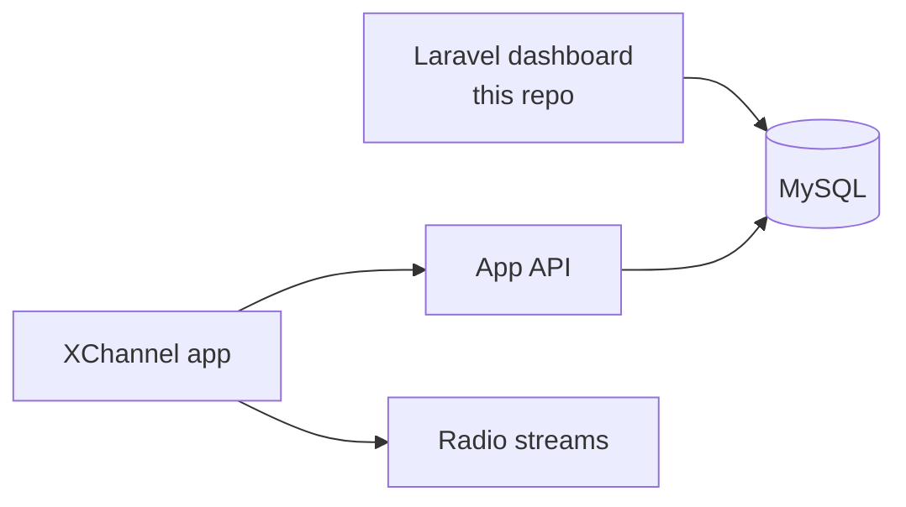
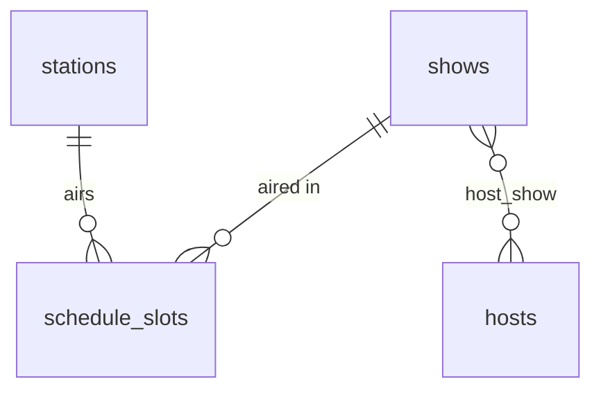

# XChannel dashboard demo

The radio part of the admin dashboard of a media app I worked on. XChannel runs local radio stations in several
cities (Jakarta, Bogor, Banten, Bandung, Surabaya, Solo); the app streams them and shows what is on. The dashboard is
where the team manages the stations, the shows, the hosts and each station's week of programmes.

Production is a **Laravel** dashboard on **MySQL**; the app reads the same tables through its API. My part was the dashboard,
so this repo rebuilds the radio section of it, on the same stack, with made-up data. Podcasts, the music chart,
video, news, games and member points also live in that dashboard but are left out here.

Part of my portfolio: https://github.com/Enricosaputra/developer-portfolio

## What it does

- **Dashboard**: what every station is on air with right now (in WIB) and what comes next, a 24-hour timeline per
  station with the empty hours marked, and airtime per week per host and per station. A day and time picker shows
  the same view for any moment of the week.
- **Stations**: city, frequency, stream URL and stream status (live, idle, offline), plus the station's whole week.
- **Schedule**: every slot on every station, filtered by station and day. One form puts a show on several days at once.
- **Master data**: shows (with their hosts) and hosts.
- Bahasa Indonesia by default, English on request (ID / EN in the sidebar).

## The rules

They live in `app/Services/ScheduleService.php` and are covered by feature tests.

| Rule | Where |
| --- | --- |
| Slots on the same station and day cannot overlap; back-to-back (10:00 - 10:00) is fine. The error names the show in the way | `clash()` |
| Scheduling a show on several days saves all of them or none | `schedule()`, in a transaction |
| A slot ends after it starts and within the day. A show past midnight is two slots: until 24:00, then from 00:00 the next day | `assertValidRange()` |
| Times are `HH:MM` from 00:00 to 24:00, in WIB. `6:00 AM`, `08.00` and `25:00` are refused | `SlotRequest`, `Clock` |
| On air now is the slot where start <= now < end; up next wraps into the next days of the week | `onAir()`, `upNext()` |
| Hours with no show are gaps: the station plays automated music then | `gaps()` |
| A host's airtime counts every slot of every show they host; co-hosts each get the full slot | `weeklyMinutesByHost()` |
| Anything in use (a show on the schedule, a host on a show, a station with slots) cannot be deleted, only made inactive | models |

## Architecture



## Data model

Built from the production schema, trimmed to the radio section.



`schedule_slots` holds `day_of_week` (1 = Monday ... 7 = Sunday, ISO) and `starts_at` / `ends_at` as minutes since
midnight, so 07:30 is 450 and 24:00 is 1440. Overlap checks and "what is on now" are plain integer comparisons, and
the index on (station, day, start) serves both.

Differences from production, on purpose:

| Production | This demo |
| --- | --- |
| One schedule table per city (`jdwl_radio_bandung`, `jdwl_radio_surabaya`, ...); a new station needs a new table | One `schedule_slots` table with a `station_id` |
| `radio.api_jadwal` holds the name of the station's schedule table, and one of them does not match the real table | Foreign key from slot to station |
| Day and time as free text: `senin-jumat`, `Monday-Friday`, `6:00 AM - 10:00 AM`, `08.00-09.00`, `20:00-24:00` | ISO day number and minutes since midnight, one row per day |
| Nothing stops two programmes overlapping | Overlap rule on save |
| Hosts as text on the programme (`Ubed & Karim`) | `hosts` table and a `host_show` pivot |
| Stream status in a separate table | `stations.stream_status` enum |
| A schedule table for a city with no station row | Not possible: slots need a station |

The real stream addresses and any listener data are not in this repo; stream URLs here point to `example.com`.

## Run it

Needs Docker:

```bash
docker compose up --build
# http://localhost:8080 , sample data is created on start
```

Or with PHP 8.1+, Composer and Node, against a local MySQL (see `.env.example`):

```bash
composer install && npm install && npm run build
cp .env.example .env && php artisan key:generate
php artisan migrate --seed
php artisan serve
```

Tests run on SQLite in memory: `php artisan test`.

## Online demo

The repo is private; the running app is public. It runs on Vercel's free plan as a PHP serverless function
(`vercel-php`). Production uses MySQL; the online demo uses a free Neon PostgreSQL database, because it needs no
credit card. Nothing in the code is tied to one database (the tests run on SQLite). Use Neon's **direct** connection
string, not the `-pooler` one: PgBouncer in transaction mode loses PDO's prepared statements. Environment variables
are listed in `deploy/vercel.env.example`. There is no login, so visitors can change data; the sample data is restored
every `DEMO_RESET_HOURS`, and an empty or outdated database is rebuilt on the first request.

## Laravel 10 and security advisories

This demo targets Laravel 10, which is end-of-life. `composer.json` ignores the advisories for `laravel/framework`
only. None of them reach this app: the debug page is off outside local, there are no signed URLs and no email
fields. A real deployment should upgrade.

## Slides

`docs/` has a walkthrough deck in Bahasa Indonesia (`XChannel-presentasi`) and English (`XChannel-walkthrough`),
each as `.pptx` and `.pdf`. The app also serves them from its root, e.g. `/xchannel-walkthrough.pdf`.

## How it is organised

```
app/Enums/                 Day (ISO 1-7), StreamStatus
app/Support/Clock.php      HH:MM <-> minutes since midnight
app/Services/              ScheduleService: overlaps, on air, up next, gaps, airtime
app/Http/Controllers/      thin resource controllers
app/Http/Requests/         validation per form
resources/views/components day-timeline, hour-ruler, stream-badge
database/seeders/          six made-up stations and a full week of shows
tests/Feature/             schedule rules, language, demo reset
```
